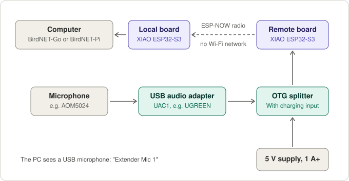
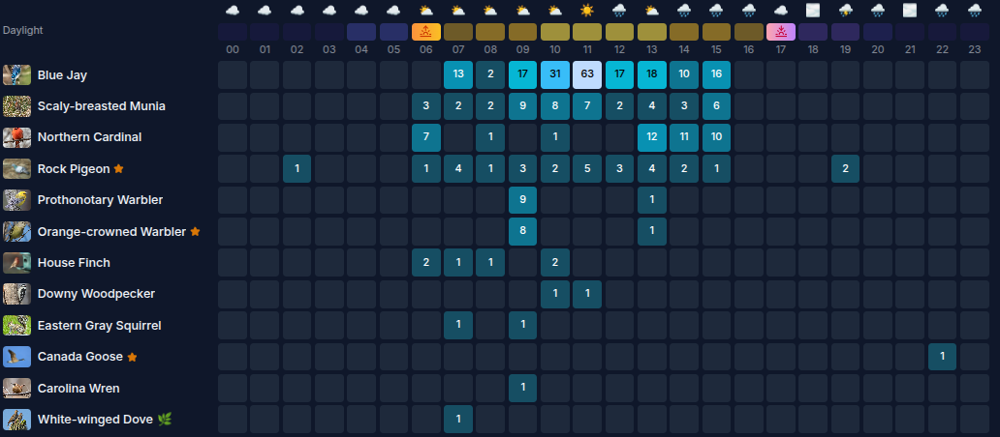

# Wireless USB Audio Extender

**Put a USB microphone far from your computer, without a cable.** Two small boards carry a USB audio adapter's sound over their own direct radio link, and the computer sees an ordinary USB microphone. No drivers, no Wi-Fi network, no soldering, no settings.

Made for **bird monitoring with [BirdNET-Go](https://github.com/tphakala/birdnet-go) or [BirdNET-Pi](https://github.com/Nachtzuster/BirdNET-Pi)**: the microphone goes outside where the birds are, the computer stays indoors. It works with any recording software on Windows, macOS or Linux, and can also run the other way round, as a [wireless speaker](docs/speaker-mode.md).

* Works out of the box: flash two boards from the browser ([web flasher](https://dalogue1.github.io/wireless-usb-audio-extender/flash/)), plug the parts together, done.
* A built-in [noise filter](docs/noise-filter.md) learns the site's background hiss and removes it.
* Up to 9 pairs side by side; each shows up as **Extender Mic 1** … **9**.
* Settings, status and diagnostic reports on the local board's own [USB drive](docs/extender-drive.md).

> **Status:** firmware 1.4.6-dev. The microphone has run for days with BirdNET-Go.

<!-- VIDEO: drag the MP4 (under 10 MB) into GitHub's editor here, or link a YouTube video. -->

### How well does it pick up birds?

One day of BirdNET-Go detections by hour (November, US Central), from a UGREEN adapter and an AOM5024 microphone (signal-to-noise ratio, SNR: 80 dB) through the extender:

The species are BirdNET's own identifications, not checked by ear.

## Parts

| Part | Qty | Example |
|:---|:---:|:---|
| Seeed XIAO ESP32-S3 with antenna | 2 | [Amazon](https://www.amazon.com/dp/B0DJ6NQFKX) |
| USB-C OTG splitter with charging input | 1 | [Amazon](https://www.amazon.com/dp/B0CQKZRDHF) |
| USB audio adapter, TRRS **or** TRS | 1 | [TRRS](https://www.amazon.com/dp/B08Y8CZB2S) · [TRS](https://www.amazon.com/dp/B01N905VOY) |
| Microphone, matching the adapter | 1 | [TRRS](https://www.amazon.com/dp/B0FYV4N2QP) ¹ · [TRS](https://www.amazon.com/dp/B0F53KLB3Y) ¹ |
| USB data cable (USB-C to USB-C or USB-A) | 1 | [Amazon](https://www.amazon.com/dp/B0GS4GDX9Y) ¹ |
| USB-C power supply, 5 V 1 A+ | 1 | [Amazon](https://www.amazon.com/dp/B0D3FZ5VQM) ¹ |
| Case, 3D printed (optional) | 2 | [Printables](https://www.printables.com/model/1275829-seeed-xiao-esp32-s3-case) (by Robert ATS Duct) |

Only the two XIAO ESP32-S3 boards are required. The links are examples, not recommendations: any equivalent part works. ¹ Not tested by the author.

**Choosing parts**

* **Boards:** an ESP32-**S3** (not the C3, C5 or C6). Its antenna is required.
* **OTG splitter:** USB-C OTG with a separate charging input, so the remote and the adapter get power.
* **Audio adapter:** **USB Audio Class 1**. Few listings say so, but one that names **Nintendo Switch or PS5** support is a good sign.
* **Microphone:** its plug must match the adapter's jack: **TRRS** (one combined headset jack) with TRRS, **TRS** (separate pink mic jack) with TRS. A mismatch gives silence. If you like soldering, you can [build your own](docs/diy-microphone.md) from a microphone capsule.
* **Data cable:** it must carry **data**, not just charge. It flashes both boards, then connects the local board to the computer.
* **Power supply:** 5 V, 1 A or more, with a USB-C plug for the splitter's charging input.

## Quick start

1. **Flash both boards** from the [web flasher](https://dalogue1.github.io/wireless-usb-audio-extender/flash/) (Chrome or Edge on a desktop computer). For each board: **hold its BOOT button while you plug it in** with the data cable (otherwise no device appears), release it, click **Install local board** or **Install remote board**, and unplug it when done.
2. **Assemble the remote:** antenna on the board, board into the OTG splitter, audio adapter into the splitter, microphone into the adapter, power supply into the splitter's charging input.
3. **Plug the local board into the computer.** Within a few seconds both LEDs link up and follow the sound.
4. **Choose "Extender Mic 1"** as the input in your software (in BirdNET-Go or BirdNET-Pi, as the audio source / sound card). That's all.

Snap the antennas on before powering the boards, keep the local board's antenna outside the computer's case, and keep the two boards at least 1 m apart.

**BirdNET-Go in Docker:** if the local board is unplugged (or disappears from the computer for any other reason, such as opening its drive), BirdNET-Go won't see it again until its container is restarted. Rebooting the computer is the simple way. See [Restarting your software](docs/troubleshooting.md#restarting-your-software).

## More

* **[Settings](docs/configuration.md)**: every `config.txt` setting, the BOOT button, factory reset
* **[The EXTENDER drive](docs/extender-drive.md)**: `report.html`, status, event log, adapter details
* **[Noise and high-pass filters](docs/noise-filter.md)**: how the filters work, and how to read the noise graph
* **[Distance and range](docs/distance.md)**: the `distance` setting, antennas, channels, transmit power
* **[Pairing and several mics](docs/pairing.md)**: mic numbers, channels, locking a pair to each other
* **[Speaker mode](docs/speaker-mode.md)**: the same boards as a wireless stereo speaker
* **[Voice feedback](docs/voice-feedback.md)**: the spoken announcements, other languages, your own voice
* **[LEDs and troubleshooting](docs/troubleshooting.md)**: what the lights mean, common problems, recovery, the serial log
* **[Building your own microphone](docs/diy-microphone.md)**: a capsule on a cable, wiring for TRRS and TRS plugs
* **[AtomS3U boards](docs/atoms3u.md)**: an even simpler extender from USB-stick-sized boards with a built-in mic
* **[Building from source](docs/building.md)**: Arduino IDE settings, firmware images, tests, how it works
* **[Acknowledgements](docs/acknowledgements.md)**: esp32-birdnet-mic and the other projects this builds on

## License

[MIT](LICENSE). The built-in voice clips were generated with [Kokoro TTS](https://github.com/hexgrad/kokoro) (Apache-2.0).
