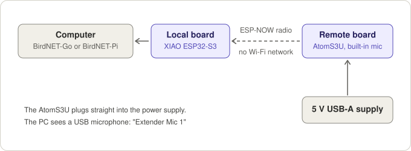
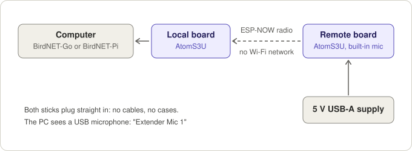

# AtomS3U boards

[← Back to the main page](../README.md)

The [M5Stack AtomS3U](https://docs.m5stack.com/en/products/sku/K125) is an ESP32-S3 the size of a USB stick, with a built-in microphone, an RGB LED, a button and a USB-A plug. It can stand in for either board of the extender. There is no antenna to attach, no case to print and nothing to assemble: flash it and plug it in.

The trade-off is shorter range (a small chip antenna instead of the XIAO's external one) and a noisier built-in mic: its signal-to-noise ratio (SNR) is 61.5 dB, against 80 dB for the AOM5024 used in the main build, and it covers about 100 Hz to 10 kHz. Faint and distant birds, and the highest-pitched songs, are picked up less often. It is the simplest way to start, and good for nearby birds; for the most range and the best sound, use the [main build](../README.md#parts).

In a side-by-side test with BirdNET-Go, both mics outdoors at the same time, the AOM5024's background noise was about 19 dB lower than the AtomS3U's, without the AtomS3U's hiss above 12 kHz. BirdNET still identified faint Blue Jay calls through the AOM5024 (42–82 % confidence) that would have been buried in the AtomS3U's background noise.

**Start simple, upgrade later.** An AtomS3U remote can be replaced at any time by a XIAO ESP32-S3 remote with a USB audio adapter and a better microphone, and an AtomS3U local board by a XIAO local board. The firmware is the same, so with the default settings the new board just takes the old one's place. If you changed `mic` or `channel`, or locked the pair, see [Pairing](pairing.md).

## Two ways to use it

### AtomS3U as the remote

The local board stays a XIAO ESP32-S3 with its antenna, at the computer. The remote is an AtomS3U plugged into a USB power supply where the birds are. It uses its own microphone: no OTG splitter, audio adapter or microphone to buy.

### Two AtomS3Us

The simplest extender: one AtomS3U plugs into the computer, the other into a power supply. The local one plugs straight into a USB-A port, so it needs no data cable either. A front port, or a short USB extension cable, keeps its antenna clear of the computer's case and gives the most range.

### Mixing boards

**There is one local firmware and one remote firmware, for both kinds of board.** Each recognises the board it is running on and adapts, and the local board adapts to the kind of remote it is paired with, so a board can be swapped for the other kind without reflashing its partner or changing a setting.

| Local board | Remote board | Modes |
|:---|:---|:---|
| XIAO ESP32-S3 | XIAO ESP32-S3 + audio adapter | microphone, speaker ([main build](../README.md)) |
| XIAO ESP32-S3 | AtomS3U | microphone |
| AtomS3U | XIAO ESP32-S3 + audio adapter | microphone, speaker |
| AtomS3U | AtomS3U | microphone |

An AtomS3U remote is always a microphone: its USB plug goes into the power supply, so there is nowhere to connect a speaker adapter. If `config.txt` asks for `mode = speaker` or `auto`, the local board stays a microphone and says why in `status.txt` and `events.txt` ("remote has built-in mic only").

## Parts

**AtomS3U as the remote**

| Part | Qty | Example |
|:---|:---:|:---|
| Seeed XIAO ESP32-S3 with antenna (local board) | 1 | [Amazon](https://www.amazon.com/dp/B0DJ6NQFKX) |
| M5Stack AtomS3U (remote board) | 1 | [M5Stack](https://docs.m5stack.com/en/products/sku/K125) |
| USB data cable for the XIAO (USB-C to USB-C or USB-A) | 1 | [Amazon](https://www.amazon.com/dp/B0GS4GDX9Y) |
| USB-A power supply, 5 V | 1 | any phone charger with a USB-A socket |
| Case for the XIAO, 3D printed (optional) | 1 | [Printables](https://www.printables.com/model/1275829-seeed-xiao-esp32-s3-case) (by Robert ATS Duct) |

**Two AtomS3Us**

| Part | Qty | Example |
|:---|:---:|:---|
| M5Stack AtomS3U | 2 | [M5Stack](https://docs.m5stack.com/en/products/sku/K125) |
| USB-A power supply, 5 V | 1 | any phone charger with a USB-A socket |

The links are examples: any equivalent part works.

## Quick start

1. **Flash the boards** from the [web flasher](https://dalogue1.github.io/wireless-usb-audio-extender/flash/) (Chrome or Edge on a desktop computer). On the flasher page, click **Install local board** for the local board and **Install remote board** for the remote, whether it is an AtomS3U or a XIAO: the same firmware runs on both. To put a board into flashing mode:
   * **AtomS3U:** plug it into the computer, then **hold the side button for about 2 s until the green LED inside lights up**, and release it.
   * **XIAO ESP32-S3:** hold its BOOT button while you plug it in with the data cable, then release it.
2. **Plug the remote AtomS3U into the power supply** where the birds are. The microphone is inside the stick, so keep it dry and out of the wind, for example under an eave or in a small open-bottomed shelter.
3. **Plug the local board into the computer.** Within a few seconds both LEDs link up and follow the sound.
4. **Choose "Extender Mic 1"** as the input in your software. That's all.

Keep the two boards at least 1 m apart.

## Range and placement

The AtomS3U's small chip antenna leaves the link less margin than the XIAO's external antenna, so where the boards sit matters more:

* **Keep a clear path between the boards.** A wall, metal (gutters, siding, appliances) or the computer's case in between can be enough to drop the link. If it drops, **move the local board first**: it is often the one behind something.
* **Set `distance = far`** in `config.txt` for the most range. It copes worst with busy Wi-Fi, which rarely matters outdoors.
* **Keep the stick clear and raise it:** away from walls and metal, and a metre or two up if you can. A short USB extension cable lets it stand away from the power supply.
* **Turn it to match the other antenna:** try the stick upright and on its side.
* **Check the signal** in `status.txt`: an RSSI better than about −75 dBm is comfortable; below about −85 dBm the link starts to drop.

## Buttons and LED

Everything works as on the XIAO boards, with the AtomS3U's **back button** in place of BOOT:

| On the AtomS3U | Does |
|:---|:---|
| Back button, click (local board) | opens the [EXTENDER drive](extender-drive.md) |
| Back button, hold 10 s | factory reset |
| Side button, press | restarts the board |
| Side button, hold about 2 s | flashing mode (green LED inside) |
| RGB LED | the same patterns as the XIAO's LED ([LEDs](troubleshooting.md#leds)) |

On an AtomS3U remote, `mic_level` in `config.txt` sets the built-in microphone's gain: `0` to `100` = 0 to +30 dB, default `100` (+30 dB) ([Mic level](configuration.md#mic-level)).

Settings, the drive, mic numbers, pairing, the `distance` setting, the noise filter and voice feedback are all the same as on the main build: see the [main page](../README.md#more).
