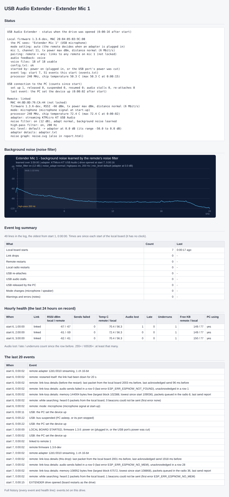

# The EXTENDER drive: settings, status and reports

[← Back to the main page](../README.md)

Click the local board's **BOOT** button and, after waiting up to 15 s for the remote, it restarts as a USB drive named **EXTENDER1** (EXTENDER2 for Mic 2, and so on, so several can be open at once; Linux mounts it as `/media/<user>/EXTENDER1`). Eject it to go back to being the microphone. If the remote is away, the drive opens after the 15 s and the files say "remote not linked". With BirdNET-Go in Docker, restart its container (or reboot) afterwards: see [Restarting your software](troubleshooting.md#restarting-your-software).

| File | What it is |
|---|---|
| `config.txt` | every setting, explained ([Settings](configuration.md)) |
| `report.html` | **everything at a glance**: open it in any browser |
| `status.txt` | what is in effect right now, on both boards |
| `events.txt` | the event log: what happened, for weeks back |
| `adapter.txt` | the remote's latest audio adapter, decoded |
| `noise.svg` | the background noise the noise filter has learned |
| `voice/` | the spoken announcements ([Voice feedback](voice-feedback.md)) |
| `README.txt` | a short note on all of the above |

**Real examples**, exactly as they came off the author's drive: [report.html](images/report-example.png) (as a picture: GitHub can't show the page itself), [status.txt](examples/status.txt), [events.txt](examples/events.txt), [adapter.txt](examples/adapter.txt), [config.txt](examples/config.txt), [README.txt](examples/README.txt) and [noise.svg](images/noise-example.svg).

**Reporting a problem?** Open the drive and send `report.html` and `events.txt` (or all the files). They hold what is needed to see what went wrong, including events from before restarts and power cuts.

## report.html

One self-contained page (no internet needed) with:

* the status of both boards (the same as `status.txt`);
* the noise graph;
* a summary of the whole event log: starts, link drops, remote restarts, USB re-attaches and stalls, mode changes, warnings, each counted with the time since the last;
* the last 24 hourly health rows as a table;
* the last 20 events.

It is a snapshot taken when the drive opened; it doesn't refresh.

[](images/report-example.png)

## status.txt

What is in effect when the drive opens: both boards' firmware and MAC addresses, the mode, mic number, channel, distance and pairing, the filters, the adapter and its level, processor speed, both chips' temperature, the USB connection counts, any voice files that couldn't be used (by name, with why), and warnings such as a second remote on the same mic number.

## events.txt

The local board keeps a log of important events in its own area of flash, separate from the drive. It survives restarts and power cuts, often exactly the moment worth knowing about.

```
start 7
    0:00:00  LOCAL BOARD STARTED, firmware 1.4.0: power on (plugged in, or the USB port's power was cut)
    0:00:01  USB: the PC set the device up
    0:00:03  linked to remote 1
1d 01:01:01  health: linked, RSSI -71 dBm (remote hears -69), remote queue 34, sends failed 120 | temp remote 68.2 C, local 41.0 C | audio lost 7, late 1, underruns 2 | mem remote 176 KB (largest 135), local 103 KB | PC using the audio
1d 01:01:01  LINK LOST to remote 1
1d 01:01:04  link to remote 1 back after 2.9 s
```

* The board has no clock: events are grouped under the start they belong to (`start 7`, counted since the log began), each with the time since that start.
* **Logged:** every start and why (power on, watchdog, crash, firmware restart), opening the drive, factory resets, USB set-up, release, suspend, resume, stalls and re-attaches, link lost and back, radio restarts, remote restarts with the remote's own reasons, errors and warnings, adapters plugged, removed or refused, no microphone signal, high temperatures, handovers, mode changes, locking, a second extender on the same mic number, and `config.txt` problems.
* **Health snapshots** give the conditions around those events: one every hour, and one just before a link loss, a remote restart, a USB stall or a radio restart. Signal strength both ways, failed sends, both chips' temperatures, audio lost or late and buffer underruns since the previous snapshot (`255+` means at least that many), and free memory. Hourly ones are marked `(hourly)`, so slow trends show.
* A real one: [events.txt](examples/events.txt) (from 1.3.6, which still wrote the start number on every line).
* The flash area holds about 3,800 events (weeks to months), the oldest giving way first. A power cut loses at most the event being written. The log survives a factory reset; flashing with **Install** (rather than Update) clears it.

## adapter.txt

When an audio adapter is plugged into the remote, the remote reads its USB descriptions and sends them to the local board, which keeps the latest set and writes it out here:

* **Result:** streaming (channels, bits), or **not usable** and why; which interface and settings the extender uses; the level control's range.
* **Device:** vendor and product ID, names, serial number, USB version, power.
* **Interfaces:** every audio path and stream decoded (terminals, volume and mute controls, sample rates, endpoints), and other interfaces such as buttons.
* **Raw descriptors** in hex, for reports about an adapter that doesn't work.

It is the quickest way to find out whether a new adapter is usable.

## noise.svg

The background noise the remote's noise filter has learned, as a picture. How to read it: [Noise filter](noise-filter.md#the-noise-graph). There is no `noise.svg` when the noise filter is off or still learning, the remote isn't linked, no adapter is streaming, the mic gives no signal, or in speaker mode; `status.txt` and `report.html` say which (and an old graph is deleted so it's never mistaken for a current one).

## When the drive is full

The files are written most important first (`status.txt`, `adapter.txt`, `noise.svg`, `events.txt`, `report.html`), each only if it fits. A file is never left half-written. If the drive is nearly full (from your own voice files), `events.txt` leaves out its oldest lines with a note saying so, and a file that doesn't fit at all is replaced by a one-line note.
