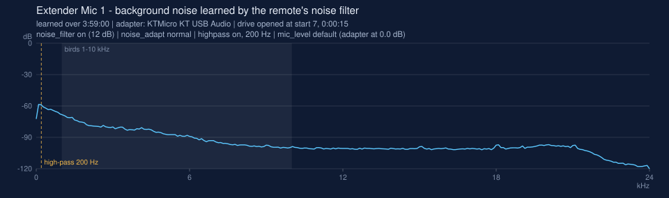

# Noise filter and high-pass filter

[← Back to the main page](../README.md)

The remote board cleans the microphone's sound before it goes over the radio, in two steps:

1. A **high-pass filter** removes the deep rumble below 200 Hz: wind, traffic, mains hum, thumps on the mic.
2. An **adaptive noise filter** learns the steady background of your site (the microphone's own hiss, the adapter's preamp, distant traffic, air conditioning) and turns it down, band by band, while sounds that come and go, such as bird calls, pass through.

Both are on by default and need no setting up. The result is a recording that sounds much cleaner, with quiet calls easier to hear.

## The noise filter

It listens for a while, finds the level that never goes away in each of 257 narrow frequency bands, and treats that as "background". Anything that rises above it is kept; sound at the background level is turned down by up to 12 dB (`noise_filter = on`) or 20 dB (`strong`).

* **Learning.** It starts fresh whenever the adapter connects. The first ~15 s pass unfiltered, it improves over the first few minutes, and the log says `background noise learned` after about 2 minutes. It keeps learning all the time, so it follows the site from day to night.
* **Steady sounds are removed too.** A sound that never stops (a fan's whine, mains hum, a stream close by) can't be told apart from background, so it is turned down as well. That's usually what you want.
* **It adds 10.7 ms of delay**, and uses about a fifth of one of the remote's two processor cores.

| Setting | Values |
|---|---|
| `noise_filter` | **on** (12 dB, default), **strong** (20 dB: clears more hiss, but can thin very quiet distant calls), **off** |
| `noise_adapt` | how quickly the learned background follows changes: **normal** (about 4 min, default), **slow** (about 16 min: less likely to mistake a long dawn chorus for background), **fast** (about 1 min: follows changing noise such as air conditioning cycling) |

Switching between on, strong and off takes effect at once: the filter keeps learning even when it's off.

## The noise graph

When you open the [EXTENDER drive](extender-drive.md), the local board asks the remote for what the filter has learned and draws it as **`noise.svg`** (also shown in `report.html`). This is a real one from the author's own pair: a UGREEN adapter (it reports itself as "KTMicro KT USB Audio") with an AOM5024 microphone, after four hours of learning:

In this one the background is about −60 dB just above the high-pass line, falls steadily through the bird band to about −100 dB at 8–10 kHz, stays flat to about 21 kHz with two small bumps (steady tones near 12 and 18 kHz), and then drops away.

**How to read it**

* **Left to right is pitch (frequency)**, from 0 Hz to 24 kHz. Low sounds (rumble, hum, traffic) are on the left, high sounds (hiss) on the right. Each point is one of the filter's 257 bands, about 94 Hz wide.
* **Top to bottom is loudness** of the background in that band, in decibels: 0 dB at the top is the loudest a full-scale tone could be, −120 dB at the bottom is the quietest the graph shows. Every 10 dB down is ten times less power.
* **The shaded area, 1 to 10 kHz**, is where most songbirds sing. A lower line there means quieter calls stand out.
* **The dashed line** is the high-pass cut-off: below it, sound is removed before the noise filter even sees it.
* **The header** says which mic, which adapter, how long the filter has been learning, and the settings in effect, so a graph shared on its own still says what it shows.

**What the shape usually means**

* **Higher on the left:** low-frequency sound is the biggest part of most backgrounds (distant traffic, wind, hum, and microphones are naturally noisier at low pitch). The high-pass filter trims the lowest part.
* **A slope down through the bird band**, levelling off into a **flat floor** on the right: the flat part is the microphone and adapter's own hiss, the quietest the chain can be.
* **A drop at the far right** (above about 21 kHz): the adapter's own built-in filter, not the site. The graph cuts off at −120 dB, so the line runs along the bottom there.
* **Bumps** are steady sounds at that pitch: a fan, a transformer's hum and its harmonics, insects that call all night.

**Comparing graphs.** The most useful comparison is the same microphone over time (day and night, before and after moving the mic, a new cable or power supply): the lower the line, the quieter the background. Comparing with graphs from other tools only works for the shape, not the numbers: every tool puts its 0 dB in a different place and splits the frequencies differently, so their levels can differ by 10–25 dB for the same sound.

There's no graph when the filter is off or still learning, the remote isn't linked, no adapter is streaming, the mic gives no signal, or in speaker mode; `status.txt` says which.

## The high-pass filter

Before the noise filter, the remote removes sound below a cut-off frequency: wind rumble, traffic, air conditioning, mains hum (50/60 Hz and its low harmonics), and thumps from the microphone or its mount.

* **On, 200 Hz** is the default (`highpass`, `highpass_hz` in [`config.txt`](configuration.md); 50–1000 Hz). Changes apply at once.
* Above the cut-off the sound is unchanged; below it, it falls away smoothly (12 dB less for every halving of the pitch: at 200 Hz, −12 dB at 100 Hz and −24 dB at 50 Hz).
* Most songbirds sing at 1–8 kHz, far above any useful cut-off, but owls, doves, grouse and bitterns call as low as 150–600 Hz. A cut-off much above 200–300 Hz starts to trim them.

## Hearing the difference

To hear what the filter does at your site, record a clip with `noise_filter = off` and run it through the same engine on a computer: `tools/noise_wav.cpp` ([how](noise-filter-technical.md#hearing-it-on-a-recording)) writes a filtered copy to compare with the original. Running BirdNET on both files is the real test of whether the filter helps detection at your site.

## More detail

* [How the filter works](noise-filter-technical.md): the processing step by step, its cost on the remote, and its tests.
* [Technical basis](noise-filter-basis.md) ([PDF](noise-filter-basis.pdf)): the published methods it is built on (spectral subtraction, minimum statistics), with references.

The level-meter LED and the no-signal check see the microphone as captured, before both filters.
