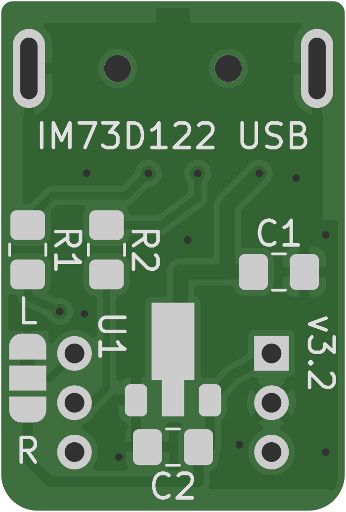

# The External PDM Microphone board

[← Back to PDM microphones](pdm-microphones.md) · [Main page](../README.md)

A small board (14.0 × 20.7 mm) that carries an Infineon IM73D122 PDM microphone module and a USB-A plug. It plugs into the remote's OTG adapter in place of a USB audio adapter. The remote finds it at start-up and reads the mic directly: see [PDM microphones](pdm-microphones.md).

*Photos of the finished board will be added here.*

| Top | Back |
|---|---|
|  |  |

## How it works

It is not a USB device: there is no USB chip and no USB protocol. The plug's four pins are used like this:

| USB-A pin | Board signal | XIAO ESP32-S3 | Notes |
|---|---|---|---|
| 1 VBUS | 5 V in | from the OTG adapter / power splitter | the XC6206 regulator makes 3.3 V for the mic |
| 2 D− | PDM clock | GPIO19 | to the mic's CLK through R2 |
| 3 D+ | PDM data | GPIO20 | from the mic's DATA through R1 |
| 4 GND | ground | GND | |

5 V never reaches the XIAO's data pins: they only carry the mic's 3.3 V signals. The remote frees GPIO19 and GPIO20 from the S3's USB hardware, sends a 3.072 MHz clock and reads the mic's bit stream, which the S3 turns into 48 kHz audio.

## Parts

| Ref | Part | Package | Notes |
|---|---|---|---|
| J1 | Molex 48037-2200 USB-A plug | surface mount + 2 shell tabs, top | DigiKey WM3983CT-ND, also Mouser, RS, Farnell. Other USB-A plugs don't fit: their pads differ |
| U1 | XC6206P332PR 3.3 V regulator | SOT-89, back | LCSC C545581 or C41322, DigiKey 4518-XC6206P332PRCT-ND. Check a copy's pinout: 1 GND, 2 IN (and tab), 3 OUT |
| C1, C2 | 1 µF ceramic, X5R/X7R, 10 V or more | 0805, back | C1 input, C2 output |
| R1 | 0 Ω (or 33–100 Ω) | 0805, back | in the DATA line. **Must be fitted**: without it the mic isn't connected |
| R2 | 0 Ω (or 33–100 Ω) | 0805, back | in the CLK line. **Must be fitted** |
| JP1 | solder jumper (no part) | back | channel: L as made, or R |
| U2 | IM73D122 mic module, 15.5 mm round | 2 × 3 pins on 2.5 mm headers, top | mic port facing up |

Use 0 Ω for R1 and R2 unless a long USB extension gives clicks or noise bursts; then try 33–100 Ω.

## Assembly

1. Solder the five small parts on the back: U1, C1, C2, R1, R2.
2. Solder J1: its four signal pads are on the top behind the plug body, and its two shell tabs go through the board and are soldered from the back.
3. Solder the IM73D122 module on the top, on its headers, with the mic port facing up. Pin 1 (the square pad) is 3V3.

**Channel jumper JP1.** As made, JP1 connects the mic's SEL pin to ground (left channel). The firmware finds the mic on either channel, so there is normally no reason to change it. To switch to the right channel, cut the thin link between the L pad and the middle pad, then bridge the middle pad to the R pad with solder. `adapter.txt` shows which channel the remote found and the JP1 setting that goes with it.

## Ordering the PCB

The Gerber files are in [`hardware/im73d122-usb-a`](../hardware/im73d122-usb-a):

* `IM73D122_USB_A_v3.2_panel_gerbers.zip`: a panel of **24 boards** (6 × 4, 94.1 × 88.9 mm), inside the 100 × 100 mm base-price size at JLCPCB and similar makers. The boards break apart at mouse-bite tabs.
* `IM73D122_USB_A_v3.2_KiCad.zip`: the KiCad 7 project (board and panel) and the scripts that generate them, for anyone who wants to change the design.

Upload the Gerber zip as it is. Options: 2 layers, **1.6 mm** thick (J1 is made for 1.6 mm boards), any finish (HASL is fine). For the panel, choose "panel by customer" with 24 boards.

## Using it

* Plug the board into the OTG adapter's USB-A socket on the remote, where the USB audio adapter would go, and power the remote through the splitter as usual.
* Only a **plain wired** OTG adapter works. One with a hub chip inside won't pass the signals through.
* A passive USB-A extension of up to about 1 m should work. Longer runs are untested, and active (repeater) extensions won't work.
* With the board plugged in, the remote's USB port isn't USB. To flash new firmware, unplug the board, then hold BOOT while plugging the XIAO into the computer.
* When the remote starts, `adapter.txt` should show `PDM microphone type: External PDM Microphone`.
