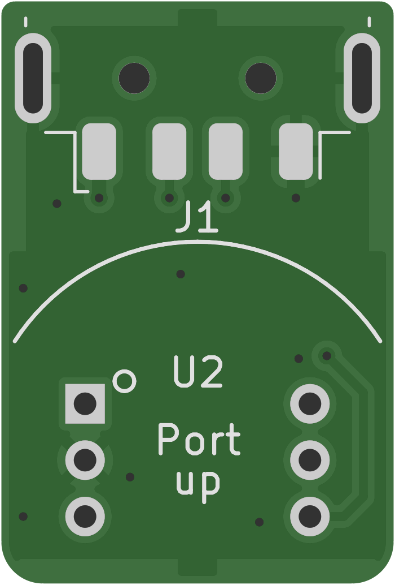
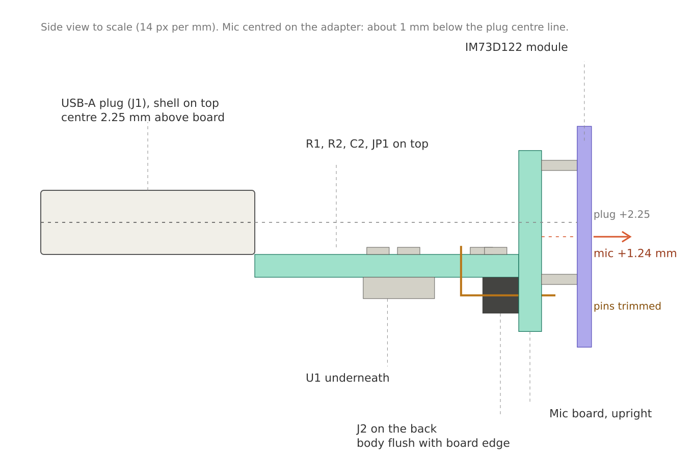
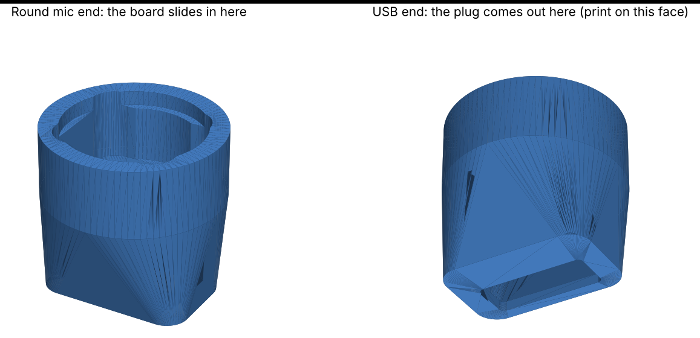
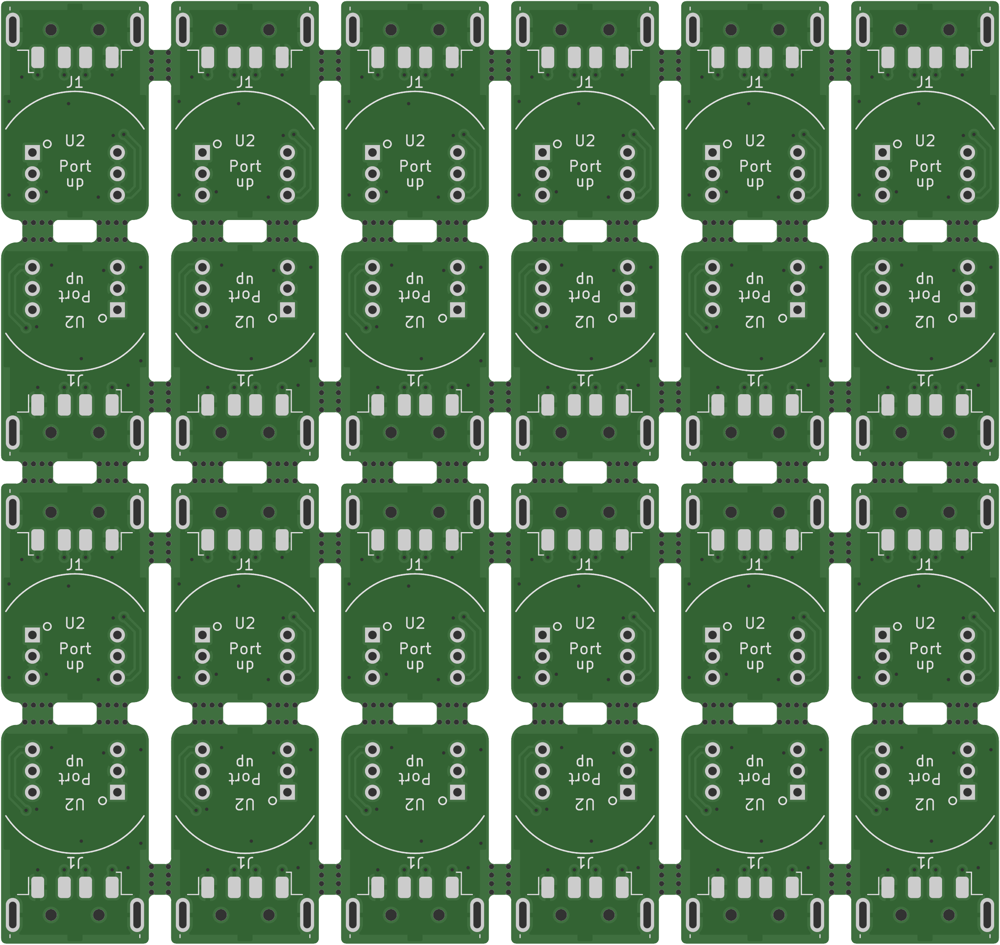

# The External PDM Microphone board

[← Back to PDM microphones](pdm-microphones.md) · [Main page](../README.md)

Two small boards joined by a 5-pin right-angle header. The **USB board** (14.0 × 18.5 mm) carries a USB-A plug and the 3.3 V regulator. A **mic board** stands upright on the header at its back edge: the IM73D122 adapter board, with an Infineon IM73D122 PDM microphone module on it, facing straight out of the back. The USB board plugs into the remote's OTG adapter in place of a USB audio adapter. The remote finds it at start-up and reads the mic directly: see [PDM microphones](pdm-microphones.md).

*Photos of the finished board will be added here.*

| USB board, top | USB board, back |
|---|---|
|  |  |

## How it works

It is not a USB device: there is no USB chip and no USB protocol. The plug's four pins are used like this:

| USB-A pin | Board signal | XIAO ESP32-S3 | Notes |
|---|---|---|---|
| 1 VBUS | 5 V in | from the OTG adapter / power splitter | the XC6206 regulator makes 3.3 V for the mic |
| 2 D− | PDM clock | GPIO19 | to the mic's CLK through R2 |
| 3 D+ | PDM data | GPIO20 | from the mic's DATA through R1 |
| 4 GND | ground | GND | |

5 V never reaches the XIAO's data pins: they only carry the mic's 3.3 V signals. The remote frees GPIO19 and GPIO20 from the S3's USB hardware, sends a 3.072 MHz clock and reads the mic's bit stream, which the S3 turns into 48 kHz audio.

The header J2 carries the mic's five signals, labelled on the USB board's top: **3V, GND, SEL, CLK, DAT**.

## The mic board

The mic board is the **IM73D122 adapter** (13.97 × 12.70 mm), with the IM73D122 module centred on it. The panel below has one adapter for every USB board. An **Adafruit PDM MEMS microphone breakout** has the same size and pin order (3V, GND, SEL, CLK, DAT) and can be used instead.

It stands on J2 upright: pin row at the bottom, mic side facing away from the USB board. Seen from the front of the mic, 3V is on the left.

## Parts

| Ref | Part | Package | Notes |
|---|---|---|---|
| J1 | Molex 48037-2200 USB-A plug | surface mount + 2 shell tabs, top | DigiKey [WM3983CT-ND](https://www.digikey.com/en/products/detail/molex/0480372200/2421361), also Mouser, RS, Farnell. Other USB-A plugs don't fit: their pads differ |
| U1 | XC6206P332PR 3.3 V regulator | SOT-89, back | LCSC C545581 or C41322, DigiKey [4518-XC6206P332PRCT-ND](https://www.digikey.com/en/products/detail/umw/XC6206P332PR/17635244) (UMW). Check a copy's pinout: 1 GND, 2 IN (and tab), 3 OUT |
| C1 | 1 µF ceramic, X5R/X7R, 10 V or more | 0805, back | regulator input. E.g. Samsung CL21B105KAFNNNE (1 µF 25 V X7R), DigiKey [1276-1066-1-ND](https://www.digikey.com/en/products/detail/samsung-electro-mechanics/CL21B105KAFNNNE/3886724) |
| C2 | 1 µF ceramic, as C1 | 0805, top | regulator output, behind J2's pins |
| R1 | 0 Ω (or 33–100 Ω) | 0805, top | in the DATA line. **Must be fitted**: without it the mic isn't connected. 0 Ω: Yageo RC0805JR-070RL, DigiKey [311-0.0ARCT-ND](https://www.digikey.com/en/products/detail/yageo/RC0805JR-070RL/728216) |
| R2 | 0 Ω (or 33–100 Ω) | 0805, top | in the CLK line. **Must be fitted**. 0 Ω: same as R1 |
| JP1 | solder jumper (no part) | top | channel: L as made, or R |
| J2 | 1 × 5 right-angle male pin header, 2.54 mm (0.1") pitch | through-hole, back | any standard right-angle header, cut from a strip. **Soldered**, not a socket |
| — | IM73D122 adapter board | from the panel | or an Adafruit PDM MEMS microphone breakout |
| U2 | IM73D122 mic module, 15.5 mm round ([Amazon](https://www.amazon.com/dp/B0HK84XMMY), [AliExpress](https://www.aliexpress.com/w/wholesale-im73d122.html)) | 2 × 3 pins on 2.5 mm headers, on the adapter | mic port facing out |

The parts were chosen to make hand soldering easier: the capacitors and resistors are 0805 size, the 3.3 V regulator is in a SOT-89 package, larger than the common SOT-23, and the microphone is a ready-made IM73D122 module ([Amazon](https://www.amazon.com/dp/B0HK84XMMY), [AliExpress](https://www.aliexpress.com/w/wholesale-im73d122.html), for reference; on AliExpress pick the round 15.5 mm module with 6 pins, 2 × 3 at 2.0 mm) with through-hole pins, instead of the bare IM73D122, whose tiny pads underneath can't be soldered with an iron.

Use 0 Ω for R1 and R2 unless a long USB extension gives clicks or noise bursts; then try 33–100 Ω.

## Assembly

1. **Small parts.** On the back: U1 and C1. On the top: R1, R2 and C2.
2. **J1.** Its four signal pads are on the top behind the plug body; its two shell tabs go through the board and are soldered from the back. The plug's shell rests on the top surface.
3. **J2 on the back** at the back edge, its plastic body flat on the board and flush with the edge, pins pointing backwards. Solder it from the top. The pins stick out about 6 mm past the edge.
4. **The IM73D122 module** onto the adapter board's front, mic port facing out. Pin 1 (the square pad) is 3V.
5. **The mic board onto J2.** Stand it upright, pin row at the bottom, mic facing away from the USB board, right against J2's body. Push J2's pins through it from its back (the side facing the USB board) and solder them on its back.
6. **Trim the pins** close to the joints, clear of the module.

**Channel jumper JP1.** As made, JP1 connects the mic's SEL pin to ground (left channel). The firmware finds the mic on either channel, so there is normally no reason to change it. To switch to the right channel, cut the thin link between the L pad and the middle pad, then bridge the middle pad to the R pad with solder. `adapter.txt` shows which channel the remote found and the JP1 setting that goes with it.

## Case

A 3D-printed tube case: the USB end is a rounded rectangle that blends into a round end, 20.4 mm across and centred on the mic, 26.1 mm long. It looks like a small microphone, and a standard foam windscreen (about 18–20 mm inside diameter) fits over the round end.

* Files: [`hardware/im73d122-usb-a/case`](../hardware/im73d122-usb-a/case): `im73d122_usb_case.stl` to print, and `im73d122_usb_case.scad` (OpenSCAD) with every size as a parameter at the top.
* **Print** it standing on the USB end. No supports are needed.
* **Fitting.** Slide the assembled boards in from the round end, plug first. The USB board's front edge stops on a 0.8 mm ledge either side of the plug hole, and the plug sticks out about 13.5 mm. The module sits loosely in its round bore (it may not be exactly centred on the adapter), and a ridge just behind it stops it.
* There is no snap or catch: the case is held by the fit and by the plug in the OTG adapter.
* Some sizes are still estimates until the boards have been built and measured: the module's front face from the adapter (`MOD_FRONT`), the depth of U1 below the board (`BOT_PARTS`), and whether the plug's shell reaches back over the board. If the fit is wrong, adjust these in the .scad file and export a new STL.
* The OpenSCAD **web** version shows this model wrongly (a false blockage in the bore). The desktop OpenSCAD renders it correctly.

## Ordering the PCB

The files are in [`hardware/im73d122-usb-a`](../hardware/im73d122-usb-a):

* `IM73D122_USB_A_v3.3_panel_gerbers.zip`: a panel of **12 sets**, 12 USB boards and 12 IM73D122 adapter boards (6 × 4, 94.1 × 68.5 mm), inside the 100 × 100 mm base-price size at JLCPCB and similar makers. Each column holds, top to bottom: a USB board, its adapter, a second adapter turned round, and a second USB board turned round. The boards break apart at mouse-bite tabs.
* `IM73D122_USB_A_v3.3_gerbers.zip`: a single USB board, without an adapter.
* `IM73D122_USB_A_v3.3_KiCad.zip`: the KiCad 7 projects (USB board, adapter and panel) and the scripts that generate them, for anyone who wants to change the design.

Upload the Gerber zip as it is. Options: 2 layers, **1.6 mm** thick (J1 is made for 1.6 mm boards), any finish (HASL is fine). For the panel, choose "panel by customer" with 24 boards (12 + 12).

## Using it

* Plug the board into the OTG adapter's USB-A socket on the remote, where the USB audio adapter would go, and power the remote through the splitter as usual.
* Only a **plain wired** OTG adapter works. One with a hub chip inside won't pass the signals through.
* A passive USB-A extension of up to about 1 m should work. Longer runs are untested, and active (repeater) extensions won't work.
* With the board plugged in, the remote's USB port isn't USB. To flash new firmware, unplug the board, then hold BOOT while plugging the XIAO into the computer.
* When the remote starts, `adapter.txt` should show `PDM microphone type: External PDM Microphone`.
