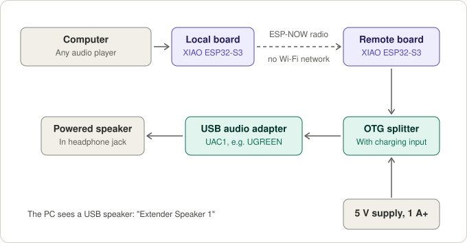

# Speaker mode

[← Back to the main page](../README.md)

The same pair of boards can carry sound the other way. The local board appears on the computer as a stereo USB speaker, **"Extender Speaker 1"**, and the remote plays whatever the computer sends through the audio adapter's headphone output, into a powered speaker.

One direction at a time: a pair is either a microphone or a speaker.

## Choosing the mode

`mode` in [`config.txt`](configuration.md):

* `mode = microphone`: always a microphone. **Recommended for unattended recording** such as BirdNET-Go or BirdNET-Pi.
* `mode = speaker`: always a speaker.
* `mode = auto` (the default): the remote decides when an adapter is plugged in, and never changes while it stays plugged in:
  * an adapter that only records → microphone; one that only plays → speaker;
  * one that does both (most do): the remote listens to its microphone side for 10 s. Any sound at all → microphone. **Pure digital silence** → speaker: adapters with jack sensing send exact zeros when nothing is in the mic jack. Meanwhile the audio already flows as a microphone.

The local board starts in its last mode straight away (the first time: microphone), so the computer has its audio device from the first second. If the remote decides otherwise, the local board restarts once as the other device. The log, `events.txt` and `status.txt` say why, for example `mode: speaker (no microphone signal at start-up)`.

**Watch out:** with `auto`, a microphone that is unplugged or loose when the remote starts makes it choose the speaker. Plug the mic in and restart the remote, or set `mode = microphone`.

**Does `auto` work with your adapter?** Leave the mic jack empty, power up the remote and wait about 20 s. If the log or `status.txt` shows `mode: speaker (no microphone signal at start-up)`, it does. An adapter that hisses with nothing plugged in counts as a microphone (the safe choice); with it, set `mode = speaker` when you want a speaker.

## Using it

1. Plug a **powered** speaker (or headphones) into the adapter's headphone/speaker jack.
2. On the computer, choose **Extender Speaker 1** as the output.
   * Linux: `aplay -l` lists it; play a file with `aplay -D plughw:CARD=E1,DEV=0 some.wav` (the card name may differ).
   * Windows: Settings → System → Sound → Output. macOS: System Settings → Sound → Output.
3. `mic_level` in `config.txt` sets the adapter's speaker level.

## What changes in speaker mode

* The noise filter, high-pass filter, no-signal check and spoken announcements are not used.
* The adapter must offer **48 kHz playback** (almost all do). `adapter.txt` shows whether it does.
* **Stereo:** left and right reach the adapter's left and right outputs. An adapter with mono playback gets the two channels mixed.
* The sound is compressed for the radio: see [How stereo is sent](#how-stereo-is-sent).
* The clocks are handled like the microphone, the other way round: the remote keeps a small buffer and gives the adapter 47, 48 or 49 samples each millisecond, following the computer's clock. Nothing is resampled.
* The serial log's stats line shows the computer side (`PC playing`, packets sent) and the remote's playback buffer (`lost`, `underruns`).

## How stereo is sent

The computer sends the local board full-quality stereo: two channels, 48,000 samples a second each. Sent as it is, that would be twice as much data as the microphone's single channel, and the radio link would have less room left to resend packets when Wi-Fi around it is busy.

So the local board compresses the sound before sending it, with a simple audio codec (IMA ADPCM). Each channel shrinks to a quarter of its size, so both channels together take **half the airtime** of one uncompressed mono channel. The remote expands them again and plays left and right through the adapter.

* **Lost packets:** the sound travels in small packets of 12 ms. Each one can be expanded on its own, so a packet lost on the way costs only that 12 ms gap, as in microphone mode, with no click or after-effect on the sound that follows.
* **Sound quality:** speech and most music sound clean. On very quiet passages and bright, busy sounds (cymbals, for example) you may hear a faint hiss that the original doesn't have.
* **Microphone mode** depends on the [`distance`](distance.md) setting: uncompressed at `near`, 8-bit µ-law at `normal` (the default; its added noise sits far below any outdoor background) and IMA ADPCM at `far`, to save airtime at the slowest radio rate. Speaker mode always uses ADPCM, whatever the `distance`.
